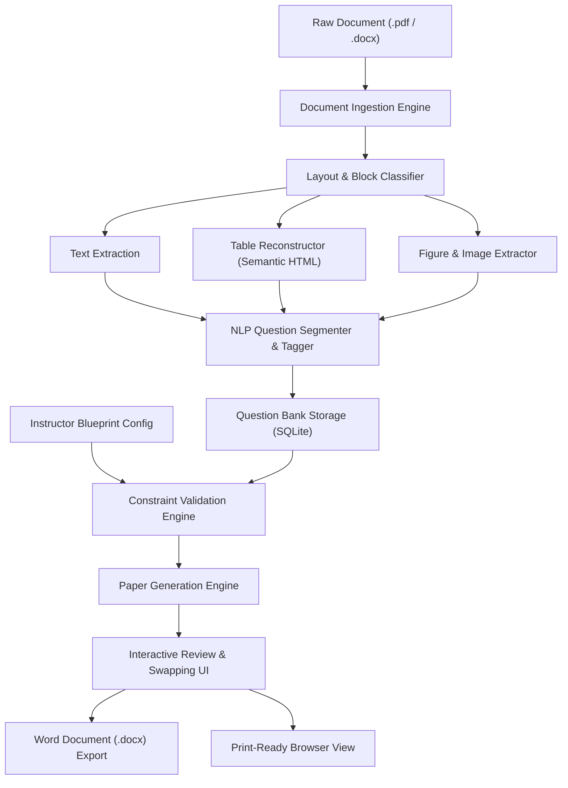

# NLP-Powered Automated Question Paper Generator

[](https://www.python.org/)
[](https://palletsprojects.com/p/flask/)
[](https://opensource.org/licenses/MIT)

An intelligent, full-stack document processing and examination authoring platform. This system extracts unstructured questions, tables, diagrams, and formulas from raw PDF and Word (`.docx`) question repositories, classifies them according to Bloom's Cognitive Taxonomy and syllabus units, manages searchable question banks, and deterministically synthesizes balanced exam question papers satisfying complex academic blueprints. Final papers can be customized interactively and exported to professionally formatted Microsoft Word (`.docx`) documents or printed directly.

---

## 👥 Authors & Contributors

- **Anuj Pawale**
- **Prathamesh Sonwalkar**

---

## 📋 Table of Contents

1. [Project Overview](#-project-overview)
2. [Key Features](#-key-features)
3. [System Architecture & Workflow](#-system-architecture--workflow)
4. [Tech Stack](#-tech-stack)
5. [Prerequisites & System Requirements](#-prerequisites--system-requirements)
6. [Installation & Setup Guide](#-installation--setup-guide)
   - [Windows (PowerShell)](#1-windows-powershell-recommended)
   - [Windows (Command Prompt / CMD)](#2-windows-command-prompt-cmd)
   - [macOS & Linux](#3-macos--linux)
7. [Running the Application](#-running-the-application)
8. [End-to-End User Guide](#-end-to-end-user-guide)
9. [Project Directory Structure](#-project-directory-structure)
10. [REST API Documentation](#-rest-api-documentation)
11. [Troubleshooting & FAQ](#-troubleshooting--faq)
12. [License](#-license)

---

## 💡 Project Overview

Creating balanced examination papers is often a repetitive, time-consuming task for educators. Faculty members must balance syllabus coverage (Units), cognitive levels (Bloom's Taxonomy: *Remember*, *Understand*, *Apply*, *Analyze*, *Evaluate*, *Create*), difficulty indices (*Easy*, *Medium*, *Hard*), attempt options (*Solve Any 3 out of 5*), and total marks, all while maintaining diagrams, mathematical equations, and formatted tables.

This project provides an automated, NLP-assisted solution that:
1. **Parses & Extracts:** Reads raw syllabus question repositories (`.pdf` and `.docx`), extracting questions alongside their embedded tables and diagram assets.
2. **Understands & Classifies:** Automatically categorizes questions by Unit/Module, Marks, Cognitive Level, and Difficulty.
3. **Stores & Manages:** Centralizes categorized questions inside a local SQLite database with full editing, re-tagging, and search capabilities.
4. **Applies Exam Blueprints:** Enforces institutional exam patterns (e.g., In-Sem, End-Sem, Class Tests) with strict mathematical verification.
5. **Generates & Exports:** Produces balanced, randomized examination papers with seed-reproducible variants (Set A, Set B), inline question swapping, and one-click export to institutional Word (`.docx`) templates.

---

## 🚀 Key Features

### 1. Document Ingestion & Multi-Modal Extraction
- **PDF Extraction:** Dual-engine parsing using **PyMuPDF (`fitz`)** for high-speed text/vector layout analysis and **`pdfplumber`** for border and cell geometry detection.
- **DOCX Extraction:** Deep paragraph, run, table, and embedded relationship traversal via **`python-docx`**.
- **Semantic Table Reconstruction:** Converts raw table bounding boxes and cell grids into clean, responsive HTML tables (`<table>`, `<tr>`, `<td>`, `colspan`, `rowspan`), preserving mathematical alignment.
- **Figure & Diagram Cropping:** Automatically isolates diagrams, circuit schemes, and graphs, storing them as discrete high-resolution image assets linked directly to the parent question.
- **Local OCR Engine:** Built-in offline ONNX-powered OCR (**RapidOCR / ONNX Runtime**) for scanned or rasterized document regions without requiring external cloud API keys.

### 2. Intelligent Question Segmentation & NLP
- **Boundary Detection:** Regular expression and heuristic segmentation to separate sequential questions, sub-questions (e.g., `Q.1 (a)`, `Q.2 (b)`), and instructions.
- **Metadata Tagging:** Automatically extracts marks targets (e.g., `[4 Marks]`, `(5M)`), Unit numbers (`Unit I`, `Unit 2`), Bloom's cognitive taxonomy, and estimated difficulty.
- **Repair Pipeline:** Sanitizes OCR artifacts, broken line-wraps, and non-standard bullet prefixes.

### 3. Centralized Question Bank Management
- **Persistence:** Local SQLite storage (`storage/question_bank.db`) with zero external database configuration.
- **CRUD Operations:** Browse, filter, search, create, update, and delete questions and question banks.
- **Asset Association:** Diagrams and tables remain safely linked to their corresponding questions across edits and re-clustering.

### 4. Flexible Blueprint Configuration
- **Section & Rule Designer:** Define main sections, target marks, and attempt rules (e.g., *Compulsory*, *Attempt Any 3 out of 4*).
- **Taxonomy & Unit Balancing:** Set exact constraints for Unit distribution, difficulty percentages, and cognitive levels.
- **Real-Time Mathematical Validation:** Live validation verifies that the selected question bank contains enough questions satisfying the blueprint constraints before initiating paper generation.

### 5. Automated Generation & Interactive Review
- **Constraint Satisfaction Engine:** Deterministic, seed-based selection algorithm ensures uniform question distribution without duplication.
- **Variant Generation:** Use different seeds to generate reproducible parallel test sets (*Set A*, *Set B*).
- **Manual Question Swapping:** Don't like a specific question? Click **Swap** to view alternative matching questions from the bank that meet the identical blueprint constraint.
- **Reordering & Customization:** Adjust question sequence and edit text on-the-fly.

### 6. Professional Export
- **Microsoft Word (`.docx`) Export:** Automatically applies formal institutional layouts (institution logo, header block, course code, duration, max marks, student instructions, aligned marks column, and properly scaled figures and tables).
- **Print View:** Dedicated CSS media queries for direct in-browser printing and PDF saving (`Ctrl + P`).

---

## 🔄 System Architecture & Workflow



---

## 🛠 Tech Stack

| Layer | Technology | Purpose |
|---|---|---|
| **Backend Framework** | Python 3.12+, Flask 3.1.3 | Lightweight, performant WSGI REST API |
| **PDF Extraction** | PyMuPDF (1.28.2), pdfplumber (0.11.10) | Text layout, vector graphics, table cell geometry |
| **Word Processing** | python-docx (1.2.0) | DOCX reading, style manipulation, and final export generation |
| **Image & OCR** | Pillow, OpenCV, RapidOCR (ONNX Runtime) | Image processing, diagram cropping, local OCR |
| **HTML Parsing** | BeautifulSoup4 | Semantic cleaning and sanitization of reconstructed tables |
| **Database** | SQLite3 | Embedded transactional storage, zero setup needed |
| **Frontend** | HTML5, Modern CSS3, Vanilla JavaScript (ES6+) | Fast, responsive single-page application with print stylesheets |

---

## 📦 Prerequisites & System Requirements

Before you begin, ensure you have the following installed on your machine:

1. **Python 3.12 or 3.13** (Python 3.14+ is also supported for core parsing; Python 3.12 is recommended):
   - Verify installation:
     ```bash
     python --version
     # or
     python3 --version
     ```
2. **pip** (Python package installer, version 23+):
   - Verify installation:
     ```bash
     pip --version
     ```
3. **Git** (for cloning the repository):
   - Verify installation:
     ```bash
     git --version
     ```

---

## ⚙️ Installation & Setup Guide

### 1. Windows (PowerShell) — *Recommended*

1. **Clone the repository:**
   ```powershell
   git clone https://github.com/<your-username>/<your-repo-name>.git
   cd "NLP question paper generator"
   ```

2. **Create a virtual environment:**
   ```powershell
   python -m venv venv
   ```

3. **Activate the virtual environment:**
   ```powershell
   .\venv\Scripts\Activate.ps1
   ```
   > *Note:* If you get an execution policy error (`running scripts is disabled`), run:
   > ```powershell
   > Set-ExecutionPolicy -ExecutionPolicy RemoteSigned -Scope CurrentUser
   > ```
   > and then run `.\venv\Scripts\Activate.ps1` again.

4. **Upgrade pip:**
   ```powershell
   python -m pip install --upgrade pip
   ```

5. **Install required dependencies:**
   ```powershell
   pip install -r requirements.txt
   ```

6. **Create your `.env` configuration file:**
   ```powershell
   Copy-Item .env.example .env
   ```

---

### 2. Windows (Command Prompt / CMD)

1. **Clone and navigate:**
   ```cmd
   git clone https://github.com/<your-username>/<your-repo-name>.git
   cd "NLP question paper generator"
   ```

2. **Create and activate virtual environment:**
   ```cmd
   python -m venv venv
   venv\Scripts\activate.bat
   ```

3. **Install dependencies:**
   ```cmd
   python -m pip install --upgrade pip
   pip install -r requirements.txt
   ```

4. **Copy environment template:**
   ```cmd
   copy .env.example .env
   ```

---

### 3. macOS & Linux

1. **Clone and navigate:**
   ```bash
   git clone https://github.com/<your-username>/<your-repo-name>.git
   cd "NLP question paper generator"
   ```

2. **Create and activate virtual environment:**
   ```bash
   python3 -m venv venv
   source venv/bin/activate
   ```

3. **Install dependencies:**
   ```bash
   python3 -m pip install --upgrade pip
   pip install -r requirements.txt
   ```

4. **Copy environment template:**
   ```bash
   cp .env.example .env
   ```

---

## ▶️ Running the Application

With your virtual environment activated, run:

```bash
python app.py
```

Expected terminal output:
```text
2026-10-22 12:00:00  INFO      backend.database  Database initialized successfully.
 * Serving Flask app 'app'
 * Debug mode: on
 * Running on http://127.0.0.1:5000 / http://0.0.0.0:5000
Press CTRL+C to quit
```

Open your web browser and navigate to:
👉 **[http://localhost:5000](http://localhost:5000)**

---

## 📖 End-to-End User Guide

### Step 1: Process a Question Bank Document
1. Open **http://localhost:5000** and select the **Document Processing** tab.
2. Drag and drop a question document (sample files are provided in the `docs/` folder: `docs/SDAUR_QB.pdf` or `docs/SA Question Paper Patttern.pdf`).
3. Click **Process Document**.
4. Review the extracted output:
   - Formatted text blocks and detected questions.
   - Reconstructed HTML tables.
   - Extracted diagrams and figures.
5. Click **Import to Question Bank**, select or create a bank, and save the questions.

### Step 2: Manage Question Banks
1. Navigate to the **Question Banks** tab.
2. View existing question banks, question counts, and creation dates.
3. Click on any bank to inspect individual questions, edit text, verify cognitive tags, or delete unwanted items.

### Step 3: Configure an Exam Blueprint
1. Click the **Blueprint & Generation** tab.
2. Define the exam structure:
   - **Total Marks** (e.g., `30`, `50`, `70`, `100`).
   - **Main Questions & Sub-Questions** (e.g., `Q1(a)`, `Q1(b)`).
   - **Attempt Rules:** Set rules such as `ALL` (compulsory) or `ANY` (e.g., *Solve Any 2 out of 3*).
   - **Constraint Filters:** Target specific Units (Unit 1–6), Cognitive Levels (*Remember*, *Understand*, *Apply*, etc.), and Difficulty ratings.
3. The live validation indicator will confirm whether your Question Bank satisfies all mathematical rules.

### Step 4: Generate, Review & Swap Questions
1. Click **Generate Paper**.
2. Review the synthesized examination paper:
   - Check mark totals and section distributions.
   - Verify question diagrams and tables.
3. If you want to change any generated question:
   - Click the **Swap Question** button next to it.
   - A modal will show other compatible questions from the bank satisfying the exact same unit, marks, and difficulty constraints.
   - Select the replacement to update the paper immediately.

### Step 5: Export Final Paper
- **Download DOCX:** Click **Export to Word (.docx)** to download a styled Microsoft Word file featuring the institutional logo, header table, instructions, and marks breakdown.
- **Print / PDF:** Click **Print View** to preview the print layout and save directly as a PDF using your browser's print dialog (`Ctrl + P`).

---

## 📂 Project Directory Structure

```text
NLP question paper generator/
├── app.py                          # Flask application entry point & factory
├── requirements.txt                # Pinned production dependencies
├── .env                            # Active environment configuration (gitignored)
├── .env.example                    # Sample environment template
├── .gitignore                      # Git exclusion rules
├── README.md                       # Comprehensive project documentation
│
├── backend/                        # Backend application package
│   ├── __init__.py
│   ├── database.py                 # SQLite initialization & connection manager
│   ├── schema.py                   # Data models & JSON schemas
│   ├── routes/
│   │   ├── __init__.py
│   │   ├── bank_routes.py          # REST endpoints for Question Bank CRUD
│   │   ├── blueprint_routes.py     # Blueprint definition & validation endpoints
│   │   ├── document_routes.py      # Upload and document processing API
│   │   └── generation_routes.py    # Paper synthesis, swapping & export API
│   └── services/
│       ├── __init__.py
│       ├── block_classifier.py     # Semantic content categorizer
│       ├── blueprint_service.py    # Blueprint constraint validation logic
│       ├── document_processor.py   # High-level extraction pipeline orchestrator
│       ├── document_profiler.py    # PDF/DOCX structure & layout analyzer
│       ├── document_validator.py   # Schema integrity & format checker
│       ├── docx_exporter.py        # Institutional Word (.docx) document generator
│       ├── docx_extractor.py       # DOCX paragraphs, tables & relation parser
│       ├── geometric_table_recognizer.py # Vector-based cell & border detection
│       ├── image_table_recognizer.py     # OCR & image table analysis interface
│       ├── paper_generator.py      # Constraint-satisfaction paper generator
│       ├── pdf_extractor.py        # PyMuPDF + pdfplumber hybrid PDF extractor
│       ├── question_bank_service.py# SQLite query logic for banks & questions
│       ├── question_segmenter.py   # Regex & heuristic question segmentation
│       ├── table_classifier.py     # Table structure classification
│       └── table_reconstructor.py  # TableData to semantic HTML converter
│
├── frontend/                       # Frontend SPA web application
│   ├── index.html                  # Single-page application interface
│   ├── styles.css                  # UI theme, typography, layout & print styles
│   ├── app.js                      # Core state router & document extraction logic
│   ├── banks.js                    # Question bank dashboard controller
│   ├── blueprint.js                # Blueprint designer & validation controller
│   ├── paper.js                    # Paper generation, editor & swapping controller
│   └── assets/
│       └── PCCOE-Logo-24.png       # Institutional logo asset
│
├── docs/                           # Reference sample files & patterns
│   ├── PCCOE-Logo-24.png           # Institution logo reference
│   ├── SA Question Paper Patttern.pdf # Standard university pattern document
│   └── SDAUR_QB.pdf               # Comprehensive sample question bank PDF
│
└── storage/                        # Persistent storage (runtime caches gitignored)
    ├── uploads/                    # User uploaded PDFs and DOCX files
    ├── extracted_assets/           # Extracted image assets from documents
    ├── paper_assets/               # Assets assigned to generated exam papers
    ├── assets/                     # General asset cache
    └── question_bank.db            # Local SQLite database (auto-created on startup)
```

---

## 🔌 REST API Documentation

| Method | Endpoint | Description |
|---|---|---|
| `GET` | `/api/health` | System health, dependency status, and OCR engine check |
| `POST` | `/api/documents/process` | Upload and parse a `.pdf` or `.docx` file |
| `GET` | `/api/documents/<doc_id>` | Retrieve parsed blocks and segmentation of a processed document |
| `GET` | `/api/banks` | List all question banks with question counts |
| `POST` | `/api/banks` | Create a new question bank |
| `GET` | `/api/banks/<bank_id>/questions` | Retrieve all questions inside a question bank |
| `POST` | `/api/banks/<bank_id>/questions` | Add a new question to a bank |
| `PUT` | `/api/questions/<q_id>` | Update question text, marks, cognitive level, or unit |
| `DELETE` | `/api/questions/<q_id>` | Delete a question from a question bank |
| `POST` | `/api/blueprints` | Save or update an exam blueprint configuration |
| `GET` | `/api/blueprints/<bp_id>/validate` | Validate blueprint constraints against question bank |
| `POST` | `/api/generate` | Generate an exam paper based on a blueprint and seed |
| `POST` | `/api/papers/<paper_id>/swap` | Swap an individual question with another matching candidate |
| `GET` | `/api/papers/<paper_id>/docx` | Download the finalized question paper as a Microsoft Word document |

---

## ❓ Troubleshooting & FAQ

### 1. `python: command not found` or `python3: command not found`
- Ensure Python 3.12+ is installed and that the **"Add Python to PATH"** checkbox was checked during installation.

### 2. PowerShell script execution error (`Activate.ps1 cannot be loaded`)
- Open PowerShell as Administrator or CurrentUser and run:
  ```powershell
  Set-ExecutionPolicy -ExecutionPolicy RemoteSigned -Scope CurrentUser
  ```
- Then retry activating the virtual environment.

### 3. Port 5000 is already in use
- Change the port in your `.env` file:
  ```env
  PORT=5050
  ```
- Or run the app on a custom port via command line:
  ```bash
  python -c "from app import create_app; create_app().run(port=5050)"
  ```

### 4. Diagram images or tables look blank in Word export
- Ensure the assets exist in `storage/extracted_assets/` or `storage/paper_assets/`.
- Ensure you have write permissions to the `storage/` directory.

### 5. RapidOCR / ONNX Runtime notices
- RapidOCR runs locally via ONNX Runtime CPU. No GPU or external API keys are required.
- If running on low-resource machines, extraction of large scanned documents (100+ pages) may take 30–60 seconds.

---

## 📄 License

This project is licensed under the **MIT License** — see the [LICENSE](LICENSE) file for details.
All sample PDFs and logos in `docs/` are for educational and academic demonstration purposes.
